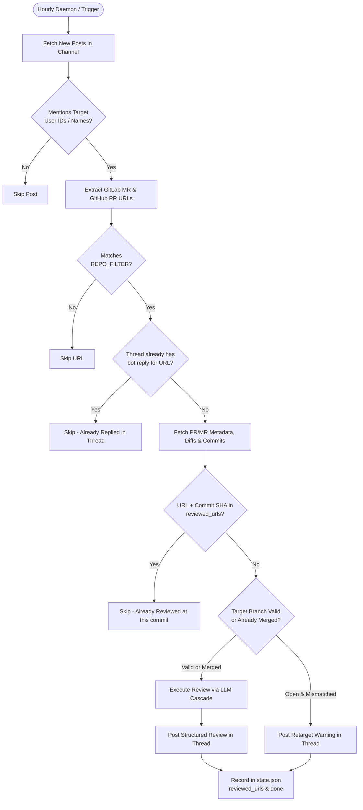

# Mattermost PR/MR Automated Reviewer 🤖

An automated AI-powered code review daemon that scans Mattermost channels (such as **"Daily Task Update"** or **"Most Important Work"**) for pull requests and merge requests sent to you, enforces target branch rules, performs in-depth AI code reviews using a rigorous rubric, and posts structured review outcomes directly back into message threads.

---

## 🌟 Key Features

### 1. Hourly Polling Daemon & Daily Scheduling
- **Continuous Polling**: Polls Mattermost every hour (`POLL_INTERVAL_HOURS=1` by default) so reviews are delivered promptly during the workday.
- **Initial Scan on Startup**: Immediately performs a review scan cycle when the container or service starts up.
- **Daily Target Schedule**: Executes a scheduled daily sweep at your configured time (e.g. `20:00` / 8:00 PM `Asia/Kolkata`).
- **On-Demand & Dry-Run Modes**: Supports immediate one-off execution via `--now` and non-mutating simulation via `--dry-run`.

### 2. Multi-Provider LLM Fallback Cascade
Never fails due to a single provider's outage, quota exhaustion, or rate limit:
```
Google Gemini (gemini-2.5-flash)
  └─► Groq (llama-3.3-70b-versatile)
        └─► Inception (deepseek-ai/DeepSeek-V3)
              └─► Azure OpenAI
                    └─► OpenAI (gpt-4o-mini)
                          └─► Anthropic Claude (claude-3-5-sonnet)
```
If any provider raises an error or runs out of credits, the engine automatically catches the error, logs a clean warning, and seamlessly falls back to the next available provider.

### 3. Multi-Layer Deduplication Engine
Guarantees that an MR/PR is never redundantly reviewed or double-posted:
- **Global URL & Commit SHA Tracking**: Tracks each reviewed MR in `data/state.json` mapped to its exact commit `head_sha`. Re-sharing an MR in multiple posts or channels will not trigger duplicate reviews unless new commits have been pushed.
- **Mattermost In-Thread Deduplication**: Before posting any reply to a thread, the bot queries Mattermost's `/posts/{post_id}/thread` API to inspect existing comments. If an automated review or warning for that MR is already present, it skips posting.
- **Per-Post Tracking**: Records `post_id|url` pairs in `data/state.json` for rapid lookups.

### 4. Dynamic User ID & Mention Resolution
- **Exact User ID Lookup**: Uses `MM_TARGET_USER_IDS` to query Mattermost user profiles dynamically by unique ID (`heueju416fr1fkxhj3rhigouzr`, `rhxx8w317tn99x71qrz1nzwe8y`).
- **Handles Multiple Accounts**: Seamlessly monitors both admin/PAT accounts and personal accounts tagged by colleagues.
- **Smart Mention Expansion**: Automatically matches exact-word mentions across username variations (`@mayank.kumar`, `@mayank.kumar1`, `@Mayank Kumar`, `@mayank`).

### 5. Target Branch Gating & Lifecycle Handling
- **Branch Validation**: Supports single or comma-separated required target branches (e.g. `TARGET_BRANCH=pre-main` or `pre-main,staging`).
- **Open MRs**: If an open MR targets the wrong branch (e.g., `dev` instead of `pre-main`), the bot replies asking the author to retarget before merging.
- **Merged MRs (`pr.state == "merged"`)**: Fully reviewed! Because merged code cannot be retargeted, the bot proceeds with the code review and adds a note: `*(Note: MR is already merged)*`.
- **Approved MRs (`pr.is_approved == True`)**: Fully reviewed! Existing human approvals on GitLab/GitHub do not block the automated AI review.

### 6. Repository Filtering
- **`REPO_FILTER`**: Restricts reviews to specific service categories (e.g., `REPO_FILTER=backend` ensures only backend MRs are reviewed when developers post multiple project links).

### 7. Rigorous Review Rubric (`pr-review` / `mr-review-gitlab`)
- **Task Completeness**: Compares code changes against linked issue requirements and PR description; flags scope creep.
- **Test Coverage**: Verifies tests for modified logic; flags deleted or weakened tests.
- **Implementation Quality**: Evaluates edge cases, error handling, defensive programming, performance, and conventions.
- **Hard Gates**: CI pipeline status, draft state, merge conflicts.
- **Verdict Scale**: `🟢 GOOD` (mergeable), `🟡 AVERAGE` (needs revisions), `🔴 BAD — BLOCK` (blocking issues).

---

## 🏗️ Architecture & Workflow



---

## 📋 Environment Configuration Reference

All settings are configured via `.env`:

| Variable | Description | Example / Default |
| :--- | :--- | :--- |
| `MM_URL` | Base URL of your Mattermost server | `https://konnect.daakia.ai` |
| `MM_TOKEN` | Mattermost Personal Access Token (PAT) | `nc63...` |
| `MM_CHANNEL_NAME` | Display name of the channel to monitor | `Daily Task Update` |
| `MM_CHANNEL_ID` | Direct channel ID (skips channel search if provided) | `d5brag66tpyrijadap8w8crfoe` |
| `MM_TARGET_USER_IDS` | Comma-separated unique Mattermost user IDs to monitor | `heueju416fr1fkxhj3rhigouzr,rhxx8w317tn99x71qrz1nzwe8y` |
| `MM_TARGET_USERNAME` | Comma-separated usernames or display names | `mayank.kumar,mayank.kumar1,Mayank Kumar` |
| `TARGET_BRANCH` | Required target branch (supports comma-separated list) | `pre-main` |
| `REPO_FILTER` | Filter substring for PR/MR URLs (leave blank to allow all) | `backend` |
| `POLL_INTERVAL_HOURS` | Interval for background polling loop in hours | `1` |
| `SCHEDULE_TIME` | Daily scheduled run time in 24h format | `20:00` |
| `SCHEDULE_TIMEZONE` | Timezone for the daily schedule | `Asia/Kolkata` |
| `LOOKBACK_HOURS` | Initial scan lookback window for the very first run | `24` |
| `GITLAB_TOKEN` | GitLab Personal Access Token (`read_api` scope) | `glpat-...` |
| `GITHUB_TOKEN` | GitHub Personal Access Token (`repo` scope) | `ghp_...` |
| `GEMINI_API_KEY` | Primary LLM: Google Gemini API Key | `AIza...` |
| `GROQ_API_KEY` | Secondary LLM: Groq API Key | `gsk_...` |
| `INCEPTION_API_KEY` | Tertiary LLM: Inception (DeepSeek-V3) API Key | `sk-...` |
| `AZURE_OPENAI_API_KEY`| Fallback LLM: Azure OpenAI Key | `...` |
| `OPENAI_API_KEY` | Fallback LLM: OpenAI API Key | `sk-...` |
| `ANTHROPIC_API_KEY` | Fallback LLM: Anthropic Claude Key | `sk-ant-...` |

---

## 🚀 Local Development

### 1. Set Up Environment
```bash
# Create and activate virtual environment
python3 -m venv .venv
source .venv/bin/activate

# Install dependencies
pip install -r requirements.txt
```

### 2. Run Automated Test Suite
```bash
pytest tests/
```
All 10 unit and workflow tests verify target branch gating, LLM fallback cascades, state tracking, and review deduplication.

### 3. Execution Commands
```bash
# Test run in dry-run mode (simulates review without posting or mutating state)
python3 main.py --now --dry-run

# Run an immediate live scan cycle
python3 main.py --now

# Start the continuous background daemon (polls every 1 hour & runs daily at 20:00)
python3 main.py
```

---

## 🐳 Docker & Dev Server Deployment

The service is designed to run 24/7 inside a lightweight Docker container (`python:3.12-slim`).

### 1. Build and Start Container
```bash
docker compose build
docker compose up -d
```

### 2. Monitor Live Logs
```bash
docker compose logs -f
```

### 3. Run On-Demand Review Inside Container
```bash
docker compose run --rm reviewer python3 main.py --now
```

### 4. Run Test Suite Inside Container
```bash
docker compose run --rm reviewer pytest
```

### 5. Restart Container
```bash
docker compose restart
```

---

## 📁 Repository Structure

```
pr-reviewer/
├── app/
│   ├── config.py              # Environment configuration & validation
│   ├── mattermost.py          # Mattermost client (posts, threads, dynamic user ID lookup)
│   ├── state.py               # JSON state persistence (tracks reviewed URLs, commit SHAs & post IDs)
│   ├── bot.py                 # Core workflow orchestrator (deduplication, branch gate, reviews)
│   ├── git_providers/
│   │   ├── base.py            # Normalized PullRequestDetails dataclass
│   │   ├── gitlab_client.py   # GitLab REST client (diffs, approvals, metadata, commits)
│   │   ├── github_client.py   # GitHub REST client (diffs, reviews, metadata, commits)
│   │   └── resolver.py        # URL extractor and branch gate validator
│   └── reviewer/
│       ├── rubric.py          # pr-review rubric & comprehensive prompt generator
│       └── llm.py             # Multi-provider LLM client with automatic fallback cascade
├── data/
│   └── state.json             # Persistent volume data storing processed state
├── tests/
│   ├── test_bot_workflow.py   # End-to-end bot workflow, deduplication, and skip logic tests
│   ├── test_branch_gate.py    # Target branch gating validation tests
│   ├── test_llm_fallback.py   # Multi-LLM provider fallback cascade tests
│   ├── test_parser.py         # URL extraction & mention regex parsing tests
│   └── test_state.py          # State persistence & commit SHA matching tests
├── main.py                    # Application entrypoint, CLI runner & scheduler daemon
├── Dockerfile                 # Multi-stage lightweight Python 3.12-slim container
├── docker-compose.yml         # Container configuration with persistent data volume
├── requirements.txt           # Python dependencies
├── .env.example               # Template environment configuration
└── pytest.ini                 # Pytest configuration
```
